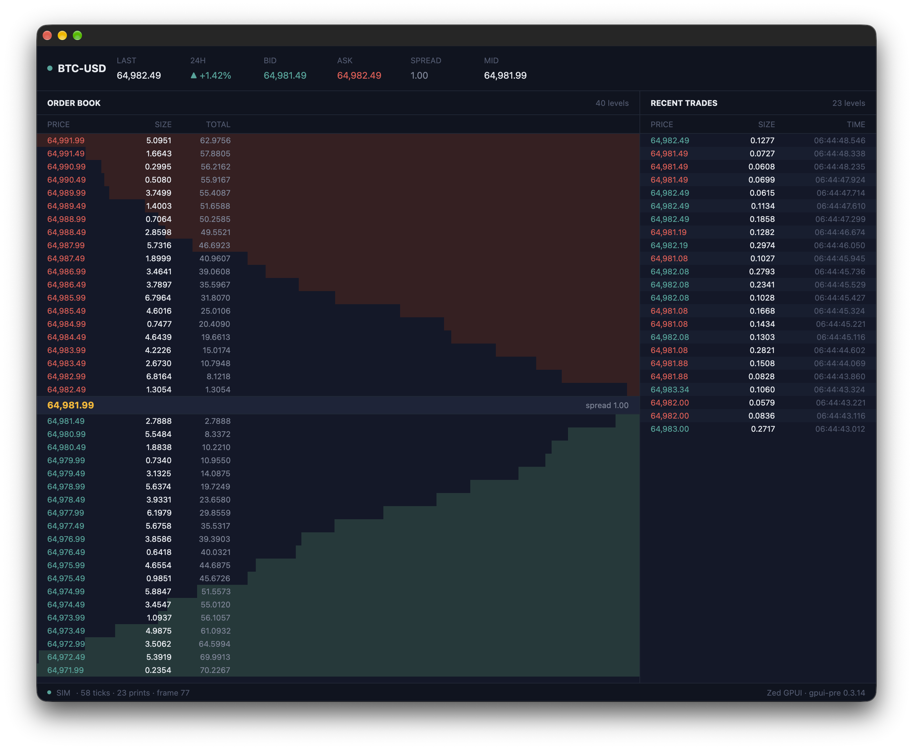

# fsrsxp_gpui_orderbook

A trading orderbook dashboard written in Rust on top of Zed's **GPUI**
framework, fed by a separate **Axum** service over a **WebSocket**. 40 price
levels (20 bid / 20 ask), live cumulative-depth bars, a rolling tape of
recent prints, and a status bar showing the live connection state.

**UI runs as a native macOS/Linux/Windows window AND in the browser** from
the same codebase. One backend serves both.

| native                                     | web (WebGPU in a `<canvas>`)                  |
| ------------------------------------------ | --------------------------------------------- |
|              |                |

<br/>

## Architecture

```
┌──────────────────────┐    GET /          → index.html + wasm       ┌──────────────────────┐
│    Web UI (WASM,     │    GET /ui-config → { ws_url }              │                      │
│    WebGPU canvas)    │  ◀──────────────────────────────────────▶    │   orderbook-feed     │
│                      │    WS   /feed    (MarketSnapshot / tick)     │   (axum 0.7)         │
└──────────────────────┘                                              │                      │
                                                                      │  Simulator @ 10 Hz   │
┌──────────────────────┐    GET /ui-config → { ws_url }              │  tokio broadcast     │
│   Native UI          │  ◀──────────────────────────────────────▶    │                      │
│   (gpui-pre window)  │    WS   /feed    (MarketSnapshot / tick)     │                      │
└──────────────────────┘                                              └──────────────────────┘
```

- One process. The Axum service serves the UI bundle (`dist/` via
  `tower_http::services::ServeDir`) alongside `/ui-config` and `/feed`, so
  the whole app is one origin — no reverse proxy, no CORS, no cross-origin
  WebSocket.
- UI fetches `/ui-config` at init time to discover the WebSocket URL, so the
  same static bundle can point at dev, staging or prod backends without a
  rebuild. The only URL baked into either UI target is where to find
  `/ui-config`; everything else, including the WS URL and scheme, comes from
  the response.
- Backend keeps one simulator running regardless of client count — a
  `tokio::sync::broadcast` channel fans the same snapshot out to every
  connected WebSocket.
- Wire format is the `fsrsxp-orderbook-proto` crate (plain serde structs),
  shared between the two binaries via a Cargo workspace.

<br/>

## Workspace

```
.
├── Cargo.toml                 # workspace root (resolver 2, tuned release profile)
└── crates/
    ├── proto/                 # Side, Level, Trade, MarketSnapshot, UiConfig  (serde)
    ├── feed/                  # Axum service — binary `orderbook-feed`
    │   └── src/
    │       ├── main.rs        # /ui-config  + /feed (WS upgrade) + ticker
    │       └── sim.rs         # simulator (ex-market.rs tick logic)
    └── ui/                    # GPUI dashboard — binary `orderbook` + wasm cdylib
        ├── src/
        │   ├── main.rs        # native launcher
        │   ├── lib.rs         # Dashboard entity + native/wasm entry points
        │   ├── market.rs      # view model (type alias on proto + MarketExt trait)
        │   ├── views.rs       # header, orderbook panel, trades panel, status bar
        │   └── feed/          # cross-target WS client
        │       ├── mod.rs
        │       ├── native.rs  # tungstenite on a dedicated OS thread
        │       └── web.rs     # gloo-net via wasm_bindgen_futures::spawn_local
        ├── assets/IBMPlexSans-Regular.ttf
        ├── index.html
        └── Trunk.toml         # just a `trunk build` config; the feed serves dist/
```

<br/>

## Stack

| crate               | version    | role                                                   |
| ------------------- | ---------- | ------------------------------------------------------ |
| `gpui-pre`          | `=0.3.14`  | Zed's GPUI, published to crates.io as a snapshot       |
| `gpui-pre-platform` | `=0.3.14`  | Native backend (Metal/Vulkan/DX); on wasm re-exports `gpui-pre-web` |
| `axum`              | `0.7`      | HTTP + WebSocket server                                |
| `tokio`             | `1`        | Async runtime for the feed service                     |
| `tower-http`        | `0.5`      | `ServeDir` for the UI bundle, permissive CORS as a safety net |
| `reqwest`           | `0.12`     | Blocking `GET /ui-config` on native (TLS features off) |
| `tungstenite`       | `0.24`     | Sync WebSocket client on native                        |
| `gloo-net`          | `0.6`      | HTTP + WebSocket client on wasm                        |
| `web-time`          | `1`        | Portable `SystemTime` (std's panics on wasm32)         |
| `serde`             | `1`        | Wire format                                            |

The UI pins still match what [`longbridge/gpui-component`](https://github.com/longbridge/gpui-component)
uses in its own workspace, so a later move to the heavier `gpui-component`
widget set (DataTable, Dock, Tiles) requires no dependency surgery.

<br/>

## Run

### Native UI

```bash
# terminal 1 — the data source
cargo run -p fsrsxp-orderbook-feed
```

```bash
# terminal 2 — the window
cargo run --release
```

Default workspace member is `crates/ui`, so the second command needs no `-p`.
Opens a 1280×1000 window centred on the display; `Cmd+Q` quits. The native UI
hits `http://127.0.0.1:7878/ui-config` by default — override with
`OB_BACKEND_URL`:

```bash
OB_BACKEND_URL=http://feed.internal:7878 cargo run --release
```

<br/>

### Web UI

```bash
cargo install trunk                       # run once
trunk build -C crates/ui                  # (or add --release)
cargo run -p fsrsxp-orderbook-feed
# open http://127.0.0.1:7878
```

Both `trunk` and `cargo` commands run from the repo root — `-C crates/ui`
points trunk at that crate's `Trunk.toml`, which still writes to
`crates/ui/dist/`.

Requires a browser with WebGPU (Chrome 144+, Safari 26+, Firefox 141+).

The feed service serves `crates/ui/dist/` at `/` through
`tower_http::services::ServeDir`, so the browser loads `index.html`, the
wasm bundle, `/ui-config` and the `/feed` WebSocket all from the same
origin. No reverse proxy, no CORS.

`trunk build --release` produces a size-tuned `dist/` (see table below)
with `.js`, `.wasm` and a copy of `index.html`. For a tighter inner
loop (watcher + feed), see **Development loop** below.

<br/>

### Development loop

Three sides, each doing one job. A change to either side rebuilds only what
depends on it; the feed already serves `dist/` and re-reads it per request, so
a browser reload is enough for UI changes.

**Terminal 1 — feed, auto-restarting on back-end changes:**

First, make sure you have `cargo-watch` installed. If not, run `cargo install cargo-watch` to install it.

Start the back-end service using `./run_dev_svc.sh` or use:

```bash
cargo watch -w crates/feed -w crates/proto -x 'run -p fsrsxp-orderbook-feed'
```

Without `cargo-watch`, you would run `cargo run -p fsrsxp-orderbook-feed` and
restart it by hand after every back-end edit.

**Terminal 2 — UI wasm, rebuilt on every save:**

Start the UI build, watch, and rebuild on changes using `./run_dev_ui.sh` or use:
```bash
trunk watch -C crates/ui
```

It writes to `crates/ui/dist/` on every edit under `crates/ui/src/`, `index.html`
or `assets/`. The feed picks up the new files automatically — nothing to restart on that side.

**Browser — reload after `✅ success`:**

No hot reload; hit Cmd+R / Ctrl+R once trunk prints `✅ success` to pick up
the new wasm bundle. The feed client doesn't auto-reconnect either, so a feed
restart also needs a reload — the status bar will sit on `OFFLINE` in the
meantime. The UI re-fetches `/ui-config` and reopens the WS on page load, so
pointing it at a different backend is just `OB_PUBLIC_WS_URL=… cargo watch …`
+ browser reload.

**What triggers what:**

| you edited                                  | feed restart | wasm rebuild | browser reload |
| ------------------------------------------- | :----------: | :----------: | :------------: |
| `crates/feed/**`                            |      ✓       |              |       ✓        |
| `crates/ui/src/**` / `index.html`           |              |      ✓       |       ✓        |
| `crates/proto/**` (wire format)             |      ✓       |      ✓       |       ✓        |

For native UI dev there's no browser step — rerun `cargo run --release`
yourself, or wrap it: `cargo watch -w crates/ui -w crates/proto -x 'run --release'`.
Run it in a separate terminal from the feed's watcher.

<br/>

### Production deployment

**Single process** (the default). Point `OB_UI_DIST` at the shipped `dist/`
and run the feed binary. One process, one port, same-origin everything:

```bash
OB_UI_DIST=/srv/orderbook/dist ./orderbook-feed
# http://your-host:7878
```

Put nginx, Caddy or your load balancer in front for TLS termination — only
if you want the browser on `https://`, which also means the WS has to be
`wss://`, and that means telling the UI about it:

```bash
OB_UI_DIST=/srv/orderbook/dist \
OB_PUBLIC_WS_URL=wss://orderbook.example.com/feed \
  ./orderbook-feed
```

```caddyfile
orderbook.example.com {
    reverse_proxy orderbook-feed.internal:7878
}
```

Caddy forwards everything — HTML, wasm, `/ui-config`, and the `/feed`
WebSocket — to the feed process; `/ui-config` returns the `wss://` URL you
set, so the HTTPS page gets a socket on a matching scheme (an HTTPS page
refuses `ws://` as mixed content).

<br/>

### Web bundle size

| profile                               | raw wasm | gzipped |
| ------------------------------------- | -------: | ------: |
| `trunk build` (dev)                   |    20 MB |       — |
| `trunk build --release`               |   7.4 MB |  2.5 MB |

The feed service doesn't compress responses itself; put Caddy/nginx in front
for gzip or brotli if you're shipping the release bundle over a slow link. The
2.5 MB gz floor is the structural cost of GPUI's own text/graphics stack —
wgpu, cosmic-text + swash + harfrust + skrifa, taffy, and ICU — because
GPUI renders everything itself through WebGPU rather than using
browser-native HTML/canvas text. The release profile is tuned for size
(`lto = "fat"`, `opt-level = "z"`, `panic = "abort"`, `strip = true`) and
`wasm-opt` is deliberately off: on `gpui-pre-web`'s output it needed
`--enable-bulk-memory-opt` and saved under 20 KB when it did run.

<br/>

## Update strategy

The `Dashboard` view owns a `Market` (the latest `MarketSnapshot`), a
`FeedClient`, and a `ConnStatus`. Both targets poll the feed and repaint:

| target  | driver                                                                    |
| ------- | ------------------------------------------------------------------------- |
| native  | `cx.spawn(…)` + `cx.background_executor().timer(50ms)` polls the feed and calls `cx.notify()`. Keeps ticking even when the window is backgrounded. |
| wasm    | render-loop: each `render()` drains the feed and calls `window.request_animation_frame()`. Snapshots arrive at 10 Hz; the repaint happens at ~60 Hz. |

The web path doesn't use the background timer because on single-threaded wasm
its runnable resumes on the main thread mid-frame and collides with the paint
borrow of `App` — a `RefCell` panic every tick (tracks zed#65289 and
longbridge/gpui-kit#3414). The render-loop pattern avoids the borrow entirely
because the poll runs inside `Render::render`, already scoped to a `Context`.

<br/>

## Feed-client transports

| target  | HTTP (one-shot `/ui-config`) | WebSocket (`/feed`)   | runs on                           |
| ------- | ---------------------------- | --------------------- | --------------------------------- |
| native  | `reqwest::blocking` (no TLS) | `tungstenite` (sync)  | dedicated OS thread; snapshots cross back via `std::sync::mpsc` |
| wasm    | `gloo-net::http::Request`    | `gloo-net::websocket` | page event loop via `wasm_bindgen_futures::spawn_local`; `Rc<RefCell<…>>` to the renderer |

No tokio in the UI binary — the dedicated-thread + sync-client design keeps
the native build small and avoids the async-runtime-inside-async-runtime
problem GPUI's executor would otherwise hit.

<br/>

## Notes

### Why not the other GPUI variants?

The brief asked for a Web UI with a choice of five GPUI variants. In late
2026:

- **Zed upstream `gpui_web`** — experimental, stable-Rust web build still
  being fixed ([zed#65289](https://github.com/zed-industries/zed/pull/65289)).
- **`gpui-pre-web` on crates.io** — the WASM path we use, via its
  `gpui-pre-platform` shim. Single canvas, needs WebGPU, falls back to
  WebGL2. Opt out of its `multithreaded` default feature to compile on stable
  Rust (`wasm_thread` otherwise pulls `#![feature(stdarch_wasm_atomic_wait)]`,
  nightly only).
- **`IAmJSD/gpui` fork** — niche, advertises a WASM backend; status table
  unverified.
- **`longbridge/gpui-kit` / `gpui-component`** — mature widget set. Desktop
  first; web support tracked open
  ([#3414](https://github.com/longbridge/gpui-kit/issues/3414)).
- **`pierreaubert/gpui-toolkit`** — advertises working WASM demos, but
  vendors its own GPUI version that conflicts with other sources.

### Colors / layout

| region | color      |
| ------ | ---------- |
| page   | `#0A0E1A`  |
| panel  | `#121829`  |
| header | `#0F1420`  |
| mid    | `#1B243A`  |
| bid    | `#26A69A`  |
| ask    | `#EF5350`  |
| accent | `#FFB400`  |

Depth bars extend from the right edge of the orderbook, width proportional
to `cumulative_size_from_best / max_side_total`.
